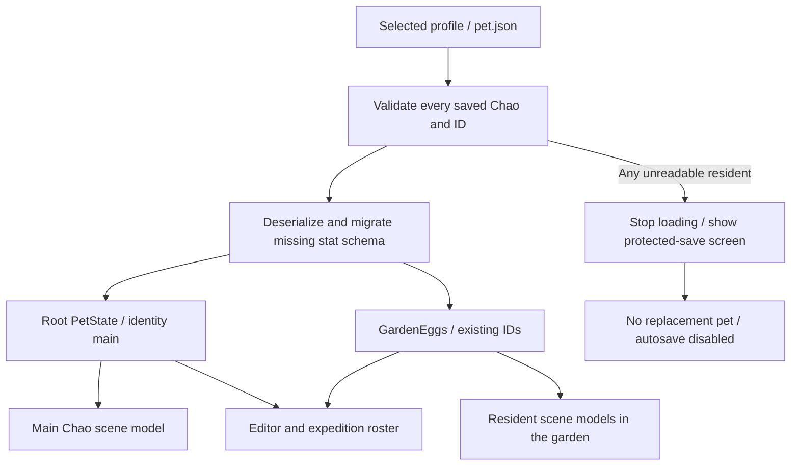

# Save identity, load safety and recovery

## Storage and data flow

Normal Play.cmd loads `user://pet.json` under Godot's `Mori · маленький сад` user-data folder. The primary Chao is the root `PetState`, with the stable logical identity `main`; it is not a member of `GardenEggs`. Other pets are `GardenEggs[].Chao`, identified by the enclosing egg's `Id`. A name or list position is never an identity.

Manual slots are `slots/slot-01.json` through `slot-20.json` in the same profile. There is no persistent selected-slot pointer: a chosen slot is loaded into memory, and later ordinary autosaves use the profile's `pet.json`. `.bak` is the previous readable file, `.tmp` is a pending write. Editor JSON is an IPC snapshot/request, not the authoritative save.

## Confirmed incident and separate risk

The November 2026 stat-preview mode intentionally creates Grade C/E/S fixtures in the separate `stats-preview` profile. Its original window title looked like the ordinary garden, and the editor did not prominently identify its data directory. Being left in that mode hid the personal garden from view; it did not imply that the personal save had been deleted. An existing personal Mori record was independently found and successfully loaded from a preserved copy. Do not replace a real save with generated fixtures to make its name appear.

The loader also had a separately reproducible data-loss risk, introduced in the original save implementation: when the primary and backup both failed, it returned a fresh `PetState`. A later autosave could overwrite the failed primary. This risk is not evidence that the particular personal save suffered that failure.

## Local fixes

- Failed primary and backup loading now throws a `SaveLoadException`; no default Mori or replacement garden is returned.
- A missing primary still checks an existing backup. Interrupted saves, editor snapshots and existing slots prevent silently starting a new garden when a former save is missing.
- The game disables gameplay/input/autosave on startup failure and displays an English protected-save screen. A partially initialized scene cannot save on focus loss or closing.
- Saving refuses to overwrite an unreadable existing primary or the only unreadable backup. Validation happens before writing a temporary file.
- A malformed hatched-pet record, blank/malformed provided ID, reserved/duplicate ID or malformed list blocks the entire load. Residents are not filtered out. Truly pre-ID legacy records receive deterministic migration IDs, persisted on a successful later save.
- Old records missing the later `GardenEggs` field receive an empty nested list, rather than a freshly generated extra egg.
- Generated stat previews have an explicit test-profile window title. The editor shows its profile and directory, and checks the profile metadata of a snapshot.
- An explicit `MORI_SAVE_DIRECTORY` opens an existing copied save for recovery. It cannot be combined with fixture-generating test modes, cannot point to a relative path, and cannot silently create a new garden if its save is missing. The editor honors the same folder. No override changes the normal Play.cmd path.

## Recovery validation

All originals must be copied with timestamps and hashes before running the game or editor. Forensic manifests, personal snapshots, paths and detailed inventories stay under the ignored local artifacts directory; never commit personal saves.

The recovery audit CLI in the test project accepts artifacts copies only. It checks complete canonical Load → Save → Load equality, stable IDs, an unchanged input file and the exported editor roster. `--recovery-check` additionally loads the real copied garden in Godot, checks the visible main and resident models, saved form/age/relations, editor roster and save/reload identities, and captures a screenshot. A baseline path is required; no fixtures are created by this mode.

Regression cases cover legacy saves, several residents, absent new fields, corrupt loading followed by saving, repeat migration, editing one resident, expedition roster ownership, and repeated save/reload. Additional cases reject ambiguous IDs, missing hatchling data, empty pseudo-saves and interrupted saves, and validate backup-only recovery.

The incident's recovered file retains all source fields. Only existing scalar skill aliases change to the already-established stat schema; original level/grade history did not exist in that older format and is not invented. Missing later memory or achievement systems use their existing defaults and are not represented as recovered historical experiences.

## Limits

This is local recovery and load protection, not a new storage backend or a complete backup manager. The personal active file is not replaced automatically. If reconstructed or partial content ever needs to be merged into it, obtain the user's approval for that exact replacement. Keep recovery output separate from the immutable original archive and from a running inspection copy.
